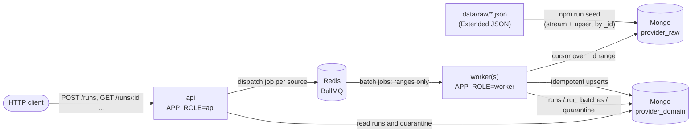
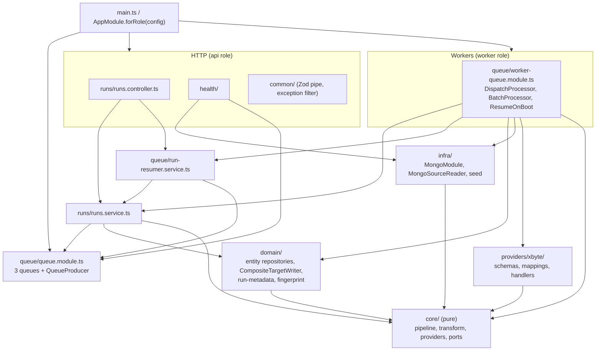
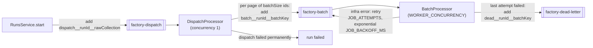
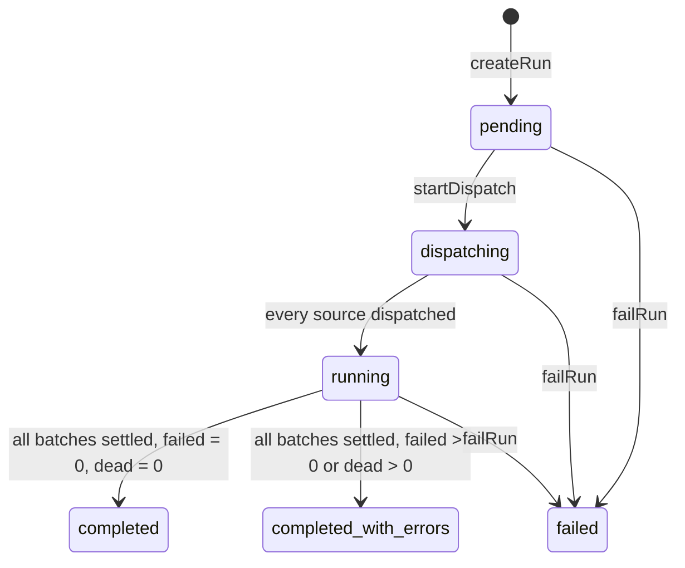

# Architecture

How the migration service is put together. For the data itself (source shapes,
anomalies, the target model and the reasoning behind it), read
**[docs/DATA_ANALYSIS.md](./docs/DATA_ANALYSIS.md)** first.

The indexes, quarantine reasons, counters and statuses named here and in
DATA_ANALYSIS are checked against the code by `src/docs-consistency.spec.ts`.

**Contents:**
1. [Components](#components)
2. [Module map](#module-map)
3. [Pipeline stages](#pipeline-stages)
4. [Queue topology](#queue-topology)
5. [Runs: state machine, counters, quarantine reasons](#runs)
6. [Why a crash at each point is safe](#why-a-crash-at-each-point-is-safe)
7. [How to add a provider](#how-to-add-a-provider)
8. [Key properties](#key-properties)

## Components

| Component | Runs as | Responsibility |
|---|---|---|
| `api` | `APP_ROLE=api` (HTTP, port 3000) | `POST /runs`, `GET /runs/:id`, `GET /runs/:id/errors`, `POST /runs/:id/resume`, `GET /health` |
| `worker` | `APP_ROLE=worker` (no HTTP; one or more containers) | BullMQ dispatch and batch workers. Resumes non-terminal runs on boot. A separate container, so `docker compose kill worker` demonstrates resumability. |
| seed / migrate / fingerprint | `npm run seed`, `npm run migrate`, `npm run fingerprint` | Load the samples into `provider_raw`; start a run from the CLI; hash the target state |
| Mongo | `mongo:7` | `provider_raw` (source, read-only by construction in the reader) and `provider_domain` (target + run metadata) |
| Redis | `redis:7` | BullMQ queues. Holds job *ranges* only, never documents. |

`APP_ROLE=all` runs both api and worker in one process (local development, the end-to-end test).

## Module map

Boundaries are enforced by lint (`.eslintrc.js`):

| Path | May not import | Why |
|---|---|---|
| `src/core/**` | `src/providers`, `src/domain`, `mongodb`, `bullmq`, `@nestjs/*` values, Node I/O / OS / crypto; no `Date.now`, `new Date()`, `Math.random`, `process`, timers | Provider-agnostic and pure: the same raw document always maps to the same records |
| everything outside `src/domain`, `src/infra`, `test/` | `mongodb` | One persistence boundary; the rest talks to ports |
| everything outside `src/config` | `process.env` | All configuration is validated by Zod at startup and injected as `AppConfig` |

## Pipeline stages

`runPipeline(raw: RawDocument[], adapter: ProviderAdapter)` in `src/core/pipeline/runner.ts`, per batch:

| Stage | Input | Output | Failure means |
|---|---|---|---|
| `validate` (handler) | `RawDocument.body` (`unknown`) | `Valid` (Zod-parsed; secrets stripped) | the whole document is rejected (`PROVIDER_ERROR`, `EMPTY_PAYLOAD`, `SCHEMA_INVALID`) |
| `normalise` (handler) | `Valid` | `Normalised` | cannot fail |
| `map` (handler) | `Normalised`, `FieldMapping[]` | `StageOutcome<DomainRecordDraft>[]` (fan-out; outcomes may carry warnings) | only that record is dropped (record-level `SCHEMA_INVALID`) |
| `stamp` (runner) | `DomainRecordDraft` | `DomainRecord` (+ `version {sourceTs, rawId}`, `source {provider, rawCollection}`) | bug: `TRANSFORM_ERROR` |
| intra-document dedupe (runner) | `DomainRecord[]` of one document | one record per key | same key with different data: `DUPLICATE_CONFLICT`, document rejected |
| `dedupe` (batch) | all accepted records | winners: max `(sourceTs, rawId)` per `(entity, key)` | n/a |
| project (batch) | winners | records sorted by `(entity, key)`, issues sorted by source | n/a |
| `TargetWriter.upsert` | `DomainRecord[]` | `WriteResult {written, unchanged, stale, retired?, byEntity?}` | infrastructure error: thrown, BullMQ retries the batch |

Any exception inside a document's stages becomes `TRANSFORM_ERROR` for that
document only. A raw collection with no handler is a wiring bug and throws.

## Queue topology

| Queue | Job id | Data |
|---|---|---|
| `factory-dispatch` | `dispatch__<runId>__<rawCollection>` | `{runId, rawCollection}` |
| `factory-batch` | `batch__<runId>__<batchKey>` (`:` → `__`; BullMQ 6 rejects `:`) | `{runId, rawCollection, fromId, toId, batchKey}`: a range, never documents |
| `factory-dead-letter` | `dead__<runId>__<batchKey>` | `{runId, batchKey, error, stack}` |

- **Deterministic ids.** BullMQ ignores a duplicate `add()`, so
  re-dispatching or resuming never double-enqueues.
- **Retries.** Every job gets `attempts: JOB_ATTEMPTS`, exponential backoff from
  `JOB_BACKOFF_MS`, `removeOnComplete: 1000` and `removeOnFail: false`. A wiring
  bug throws `UnrecoverableError`, because retrying can't help.
- **Dispatcher.** It pages with `SourceReader.scanIds` and resumes after
  `dispatchCursor`. Per page it upserts the batch row, then enqueues the job,
  and only then moves the cursor, so a crash never skips a range.
- **Dead letter.** In the `failed` event, after the last attempt, the batch is
  marked `dead`, `batchesDead` and `lastError` are recorded, and the run is
  finalised once nothing else is pending.
- **Killed workers.** Stall recovery is validated config:
  `WORKER_LOCK_DURATION_MS` (30 s), `WORKER_STALLED_INTERVAL_MS` (15 s) and
  `WORKER_MAX_STALLED_COUNT` (2), applied in `src/queue/queue.constants.ts`. A
  dead worker's lock expires, and a live worker requeues the job within the
  stalled interval.

## Runs

Everything needed to answer "what did this run do?" lives in three collections
(`src/runs/runs.service.ts`; Mongo implementations in `src/domain/run-metadata`).

| Collection | One document per | Holds |
|---|---|---|
| `runs` | run (`_id` = runId, a UUID) | status, filters, config, per-source dispatch progress, counters, timings, a capped `errorSample` (`ERROR_SAMPLE_SIZE`), `lastError` |
| `run_batches` | `_id` range (`batchKey` = `rawCollection:fromId:toId`) | batch status, attempts, the batch's counters, `lastError` |
| `quarantine` | issue (`runId, rawCollection, sourceId, reason, path`) | reason, message, path, sanitized details, severity, stage, batch and job |

### Run statuses

| Run status | Meaning |
|---|---|
| `pending` | created, dispatch not started |
| `dispatching` | dispatch jobs are paging the sources |
| `running` | every source dispatched; batches still settling |
| `completed` | all batches completed, nothing failed |
| `completed_with_errors` | finished, but `failed > 0` or a batch is dead |
| `failed` | a run-level failure (e.g. a dispatch failed permanently) |

| Batch status | Meaning |
|---|---|
| `queued` | registered, waiting for a worker (also after a failed attempt) |
| `active` | a worker is processing it |
| `completed` | settled; its counters were applied to the run exactly once |
| `dead` | settled; attempts exhausted, sent to the dead-letter queue |

### Run counters

Every batch reports these. The run's totals are their sum over completed batches.

| Counter | Definition |
|---|---|
| `read` | raw documents read |
| `transformed` | domain records produced (after in-batch dedupe), i.e. sent to the writer |
| `written` | records inserted or modified |
| `unchanged` | records matched with no change (what a re-run produces) |
| `stale` | records rejected because the stored version is newer |
| `deduplicated` | in-batch losers (same key, older version) |
| `skipped` | `EMPTY_PAYLOAD` documents: quarantined for visibility, but not failures |
| `failed` | quarantined documents/records with error severity, excluding skips |
| `warnings` | repairs that were reported but still written (e.g. merged categories) |

Invariant: `written + unchanged + stale = transformed`.

### Quarantine reasons

| Reason | Raised when |
|---|---|
| `PROVIDER_ERROR` | the payload is a provider error page (`Message`, `Page Error Message`, `error` with no results); `statusCode` is always 200, so the body is the only signal |
| `EMPTY_PAYLOAD` | no results and no error marker (counted as `skipped`, not `failed`) |
| `SCHEMA_INVALID` | the document fails the Zod schema, or one element is unusable (an unparseable listing URL, `outletCode` ≠ URL id, an unmapped country, a value a normaliser rejects) |
| `TRANSFORM_ERROR` | code threw while transforming: a bug, quarantined per document so the batch continues |
| `DUPLICATE_CONFLICT` | error: one document emits the same key with different data. Warning: a repair was applied (real categories sharing an id were merged) |

### Exactly once, and crash-safe

- **Exactly once.** A batch's counters reach the run only through the call that
  moves the batch to a settled status, a guarded `findOneAndUpdate`. Retried or
  duplicated completions add nothing.
- **Finalisation trusts `run_batches`.** The batch and the run are separate
  documents, so a crash can land between "batch completed" and "run
  incremented". Finalisation recomputes counters and batch totals from
  `run_batches`, and is re-attempted on every settle, on dispatch completion
  and on resume.
- **Quarantine idempotency.** Entries are upserted on their identity, so
  retries never duplicate them. They are paginated by `_id` cursor
  (`GET /runs/:id/errors`).

## Why a crash at each point is safe

| Crash point | Why it is safe |
|---|---|
| **Mid-read** (batch reading its `_id` range) | Nothing was written yet. The job's lock expires, the stall checker requeues it, and the range is re-read (ranges are stable). |
| **After upsert, before `completeBatch`** | Upserts are idempotent (natural key + `source.version` guard), so the retry rewrites the same values (`unchanged`). Counters are applied only by the call that settles the batch. |
| **Mid-dispatch** | Each page is: batch row upsert → enqueue with a deterministic id → move `dispatchCursor`. A retry resumes after the cursor; repeating a page is a no-op. |
| **Worker killed** (`docker compose kill worker`) | Its active jobs stall and are requeued after the lock expires. Completed batches are settled in `run_batches` and skipped. Verified on Docker (README) and in `test/integration/factory.int-spec.ts`. |
| **Redis lost state** | Resume on boot (and `POST /runs/:id/resume`) re-enqueues dispatch jobs and unsettled batches whose job is missing or dead. Live jobs are never touched. |
| **Before finalisation** | Finalisation recomputes totals from `run_batches` and is re-attempted on every settle, on dispatch completion, and on resume. |

## How to add a provider

The seam is `src/core/providers/provider-adapter.ts`. No engine code changes.

1. **Schemas.** Create `src/providers/<name>/schemas.ts`: Zod schemas for each
   raw collection, declaring only the fields you use (`z.object` strips the
   rest, secrets included). Model it on `src/providers/xbyte/schemas.ts` and
   `envelope.ts`, which handle error-page detection and sanitising.
2. **Mappings.** Write `src/providers/<name>/mappings.ts`:
   - declarative `FieldMapping[]` per entity, plus the field-ownership table if
     it writes restaurants;
   - a `TransformRegistry` with any bound transforms;
   - `compileMapping` at module init, so unknown transform names fail there.

   See `src/providers/xbyte/mappings.ts`.
3. **Handlers.** Write `src/providers/<name>/handlers/*.handler.ts`: one
   `SourceHandler` per raw collection (`rawCollection`, `alias`, `batchSize`,
   `validate`, `normalise`, `map`). Key entities on **platform**, not provider.
4. **Adapter and module.** Add `<name>.adapter.ts` returning
   `{provider, platform, sources}`, and `<name>.module.ts` providing it under a
   token (see `src/providers/xbyte/xbyte.module.ts`).
5. **Register.** Import the module in `src/providers/providers.module.ts` and
   add its token to the registry factory's `inject`. Registration validates
   the mappings (startup fails on errors) and rejects duplicate raw
   collections or aliases. Add fixtures under `test/fixtures/<name>/` and a
   handler spec like `src/providers/xbyte/xbyte.adapter.spec.ts`.

## Key properties

- **Idempotent.** Every target write is an upsert on a unique natural key,
  guarded by a sortable `source.version` (`sourceTs|rawId`). Target documents
  hold no run-specific values, so two runs give the same fingerprint, and the
  second writes nothing.
- **Resumable.** Progress is per `_id` range in `run_batches`. Killing a worker
  loses at most its in-flight ranges, which are retried safely.
- **Memory-bounded.** Raw data is read with cursors in `_id` ranges. Menus use
  a smaller batch (`BATCH_SIZE_MENUS`), and Redis never holds documents.
- **Fail-fast config.** The environment is validated with Zod before anything
  boots (`src/config/env.schema.ts`).

See [DATA_ANALYSIS.md §5–7](./docs/DATA_ANALYSIS.md#5-indexes-and-why) for
indexes, trade-offs and scale assumptions.
