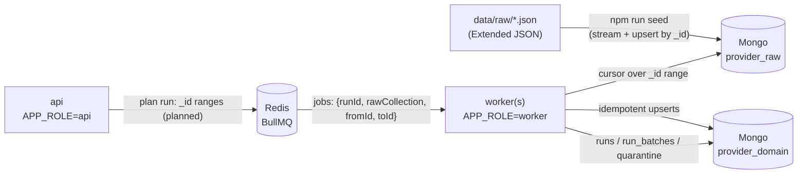
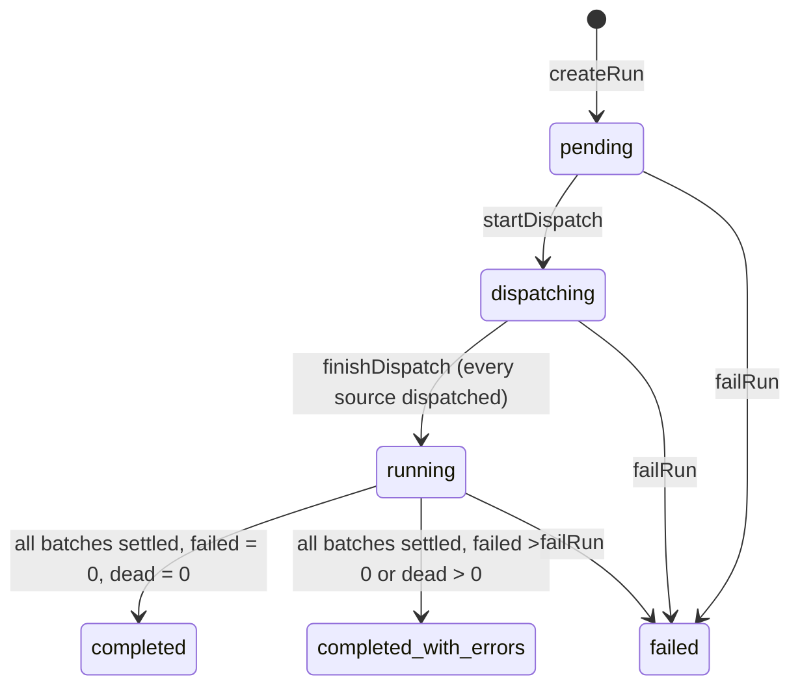

# Architecture

How the migration service is put together. For the data itself (source shapes,
anomalies, the target model and the reasoning behind it), read
**[docs/DATA_ANALYSIS.md](./docs/DATA_ANALYSIS.md)** first.

> Status: T01–T08 are built (bootstrap, raw seed, core pipeline, transforms, xbyte provider, Mongo repositories, runs). Sections marked
> *planned* describe the design that later tickets implement.

## Components

| Component | Runs as | Responsibility |
|---|---|---|
| `api` | `APP_ROLE=api` (HTTP, port 3000) | Health today. *Planned:* start runs, report progress, page through quarantine. |
| `worker` | `APP_ROLE=worker` (no HTTP; one or more containers) | *Planned:* process `_id`-range jobs: read raw, transform, upsert target. A separate container, so `docker compose kill worker` can demonstrate resumability. |
| seed | `npm run seed` | Streams the sample files into `provider_raw` (T02) |
| Mongo | `mongo:7` | `provider_raw` (source, read-only by convention) and `provider_domain` (target + run metadata) |
| Redis | `redis:7` | BullMQ queues. Holds job *ranges* only, never documents. |

## Layers

| Path | Contains | May import |
|---|---|---|
| `src/core/**` | Provider-agnostic, pure logic and interfaces | Not `src/providers`, `src/domain`, `mongodb`, `bullmq` or `@nestjs/*` values (lint-enforced) |
| `src/providers/**` | Per-provider knowledge: Zod schemas, declarative mappings, source handlers (xbyte, T06) | core, domain |
| `src/domain/**` *(planned)* | Target collections, upsert writers, indexes (T07) | core |
| `src/infra/**` | Mongo client, SourceReader, raw seed (T02/T07) | core |
| `src/config`, `src/logging` | Configuration and logging | anything |

Transforms are pure. They don't call `Date.now()` or `Math.random()`, do no I/O
and hold no module-level state, so the same raw document always maps to the same
target document. Bad data surfaces as a `DocumentError` result, which goes to
quarantine and lets the run continue. Infrastructure failures throw, and BullMQ
retries them.

## Runs

A run migrates one or more raw collections. Everything needed to answer "what
did this run do?" is persisted in three collections (`src/runs`, with the Mongo
implementations in `src/domain/run-metadata`):

| Collection | One document per | Holds |
|---|---|---|
| `runs` | run (`_id` = runId, a UUID) | status, filters, config, per-source dispatch progress, counters, timings, a capped `errorSample`, `lastError` |
| `run_batches` | `_id` range (`batchKey` = `rawCollection:fromId:toId`) | status `queued`/`active`/`completed`/`dead`, attempts, the batch's counters, `lastError` |
| `quarantine` | issue (`runId, rawCollection, sourceId, reason, path`) | the issue (reason, message, path, sanitized details, severity), its batch and job |

### Run counters

Every batch reports these counters. The run's counters are their sum over completed batches.

| Counter | Definition |
|---|---|
| `read` | raw documents read |
| `transformed` | domain records produced (after in-batch dedupe), i.e. sent to the writer |
| `written` | records inserted or modified |
| `unchanged` | records matched with no change (what a re-run produces) |
| `stale` | records rejected because the stored version is newer |
| `deduplicated` | in-batch losers (same key, older version) |
| `skipped` | `EMPTY_PAYLOAD` documents: quarantined for visibility, but not failures |
| `failed` | quarantined documents/records with error severity, excluding skips |
| `warnings` | repairs that were reported but still written (e.g. merged categories) |

Invariant: `written + unchanged + stale = transformed`.

### Exactly once, and crash-safe

- **Exactly once.** A batch's counters reach the run only through the call that
  moves the batch to a settled status (`findOneAndUpdate({status: {$nin:
  [completed, dead]}})`). A retried or duplicated completion finds nothing to
  transition and adds nothing.
- **Crash-safe.** The batch and the run are separate documents, so a crash can
  land between "batch completed" and "run incremented". Finalisation therefore
  never trusts the run's live counters: it **recomputes** them, and every
  source's batch totals, from `run_batches`. It is re-attempted on every
  settled batch and on `finishDispatch`, so the retried job still finalises
  the run with correct totals.
- **Quarantine.** Entries are upserted on their identity, so a retried batch
  never duplicates them. The first occurrence is kept. They are paginated by
  `_id` cursor and can be filtered by reason or severity.

## Key properties

- **Idempotent.** Every target write is an upsert on a unique natural key,
  guarded by `source.sourceTs`. Target documents hold no run-specific values,
  so two runs produce the same target state.
- **Resumable.** Progress is per `_id` range in `run_batches`. Killing a worker
  loses at most the in-flight range, which is retried safely.
- **Memory-bounded.** Raw data is read with cursors in `_id` ranges. Menus use
  a smaller batch (`BATCH_SIZE_MENUS`), and Redis never holds documents.
- **Fail-fast config.** The env is validated with Zod before anything boots
  (`src/config`).

See [DATA_ANALYSIS.md §5–7](./docs/DATA_ANALYSIS.md#5-indexes-and-why) for
indexes, trade-offs and scale assumptions.
