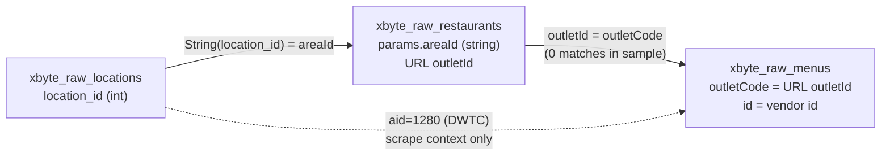
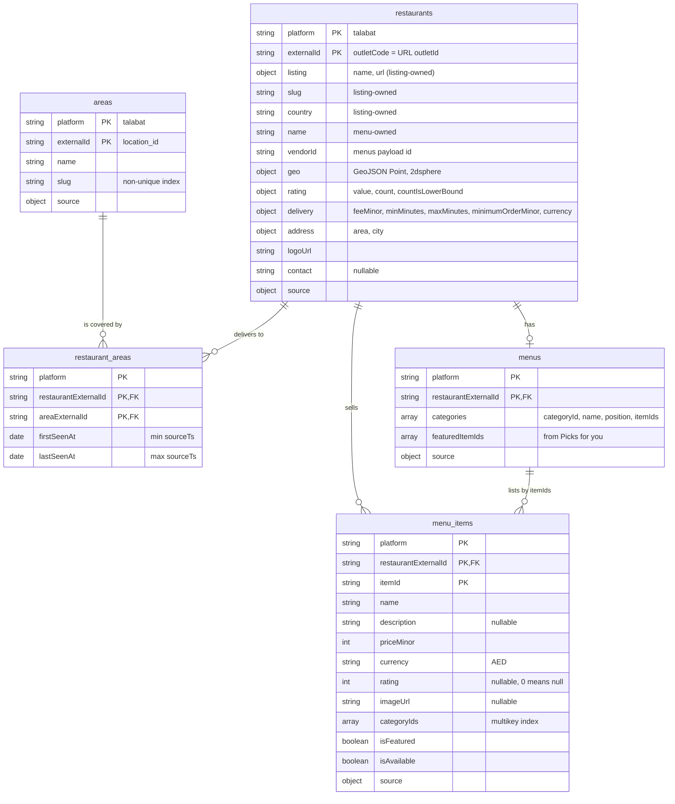

# Data analysis and target model

This document is the reasoning behind the migration. It covers what the three
provider samples actually contain, how they relate, what is wrong with them,
the target model we map them into, and the trade-offs behind each decision.
Code in T06 (mapping) and T07 (target writes) implements what is written here.

**Every number below is reproducible.** Seed the raw database (`npm run seed`),
then run the profiler against it:

```bash
docker compose exec -T mongo mongosh --quiet provider_raw --eval "$(cat scripts/profile-raw.mongosh.js)"
```

The profiler never prints `endpoint` or `requests_url`, because both contain a live provider API key.
A few numbers differ from the summary in CLAUDE.md's *Data findings*. See
[Corrections](#corrections-to-the-data-findings) at the end.

**Contents:**
1. [Source shapes](#1-source-shapes)
2. [Relationships](#2-relationships)
3. [Anomalies](#3-anomalies)
4. [Target model](#4-target-model)
5. [Indexes and why](#5-indexes-and-why)
6. [Trade-offs](#6-trade-offs)
7. [Scale assumptions](#7-scale-assumptions)
8. [Open questions](#8-open-questions-for-t06t07)

---

## 1. Source shapes

The provider is **xbyte**, a scraping vendor, and the platform scraped is **talabat**.
There are three collections and 578 documents in total. All files are
[MongoDB Extended JSON](https://www.mongodb.com/docs/manual/reference/mongodb-extended-json/)
arrays (`{"$oid": …}`, `{"$date": …}`), so they are parsed with `EJSON`, never
`JSON.parse` (see `src/seed/seed-raw.ts`).

### 1.1 Shared envelope (all 578 documents)

| Field | Type | Notes |
|---|---|---|
| `_id` | ObjectId | Unique per raw document. Becomes `source.rawId` in the target. |
| `domain` | string | Always `"talabat"` (578/578). This is the **platform**. |
| `endpoint` | string | Provider API URL. **Contains `api_key=` in 508/578.** The 70 listing docs have no query string here. Never copied anywhere. |
| `params` | object | Request parameters. The shape differs per collection (below). |
| `payload` | object | Response body. The shape differs per collection (below). |
| `payload.request_log.requests_url` | string | Full request URL. **Contains `api_key=` in 578/578.** Never copied anywhere. |
| `payload.request_log.request_time` | string | Naive timestamp `"2026-09-13 21:59:25.058370"`. It is exactly 7 h behind `createdAt` on 578/578, i.e. a UTC-7 local clock. |
| `payload.request_log.request_process_time` | string | A number stored as a string (578/578). Not used. |
| `payload.request_log.statusCode` | number | Always 200. |
| `statusCode` | number | Always 200 (578/578), **including error payloads**. |
| `createdAt` | Date | UTC. **The source timestamp (`sourceTs`)** for everything. |
| `updatedAt` | Date | Equal to `createdAt` on 578/578, so it carries no information. |
| `__v` | number | Mongoose version key, always 0. |

Scrape windows (`createdAt`): locations and listings were scraped on 2026-09-14
between 04:59 and 05:13 UTC. Menus were scraped on 2026-07-22 between 08:11 and
09:28 UTC, **54 days earlier**.

### 1.2 `xbyte_raw_locations` (8 docs)

| Field | Type | Notes |
|---|---|---|
| `payload.results[]` | array | 697 rows in every doc. |
| `results[].location_id` | int | **Natural key.** 697 unique. |
| `results[].location_name` | string | e.g. `"Al Zaab"`. One name has a double space. |
| `results[].location_slug` | string | e.g. `"al-zaab"`. 685 distinct, so **not unique** (see anomalies). |

There is no city, country or geo field. The 8 documents carry identical result
sets: 5,576 rows reduce to 697 unique locations and 1 distinct snapshot.

### 1.3 `xbyte_raw_restaurants` (70 docs): area listing pages

| Field | Type | Notes |
|---|---|---|
| `params.domain` | string | `"talabat"` |
| `params.areaSlug` | string | `"al-zaab"` (54 docs) or `"al-rowdah"` (16 docs) |
| `params.areaId` | **string** | `"1468"` (Al Zaab) or `"1461"` (Al Rowdah). A string, while `location_id` is an int. |
| `params.page_no` | int | 0–18 (al-zaab) and 0–13 (al-rowdah): 33 distinct `(area, page)` pairs |
| `payload["Total Page"]` | int | 227 on 68 docs, 1 on the "page limit" doc, absent on the `error` doc. Not trustworthy. |
| `payload["Page Error Message"]` | string | Only on 1 doc: `"Page limit exceeded."` |
| `payload.error` | string | Only on 1 doc: `""` |
| `payload.results[]` | array | 15 rows (65 docs), 14 (2), 8 (1), 0 (2 error docs). 1,011 rows in total. |
| `results[].area_name` | string | `"Al Zaab"` / `"Al Rowdah"`, the listing area |
| `results[].restaurant_name` | string | 290 distinct names for 302 outlets |
| `results[].restaurant_url` | string | `https://www.talabat.com/{country}/restaurant/{outletId}/{slug}?aid={areaId}` |

The restaurant id exists **only inside `restaurant_url`**. All 1,011 URLs parse.
The country segment is `uae` on 1,011/1,011, and `aid` equals `params.areaId` on 1,011/1,011.

### 1.4 `xbyte_raw_menus` (500 docs: 13.7 MB / ~27 KB per doc as JSON, 18.9 KB average and 153.8 KB max as BSON)

| Field | Type | Notes |
|---|---|---|
| `params.restaurant_url` | string | 500 distinct. Same URL pattern as listings; `aid=1280` on 500/500. |
| `payload.Message` | string | Only on the 155 failed docs: `"This is not restaurant page (Talabat)."` |
| `payload.results` | array | Present on 345 docs, always **exactly 1** element: the restaurant |

Restaurant object (`payload.results[0]`, 345 docs). Key naming mixes camelCase,
PascalCase and spaces:

| Field | Type | Notes |
|---|---|---|
| `id` | int | Provider **vendor id**. 345 distinct. **Never equals the URL id** (0/345). |
| `outletCode` | int | **Equals the URL outlet id on 345/345.** The join key. |
| `name` | string | 344 distinct of 345. 8 have leading or trailing whitespace. |
| `logo` | string | Image URL |
| `latitude`, `longitude` | **string** | All numeric. lat 25.06–25.34, lng 55.13–55.61 (Dubai). |
| `rate` | int \| float | 0–5. 314 non-integer. 0 on 3 (all with `totalRatings` 0). |
| `totalRatings` | int | 0–1000. **Exactly 1000 on 173/345**, a display cap. |
| `totalReviews` | int | 0 on 345/345 |
| `deliveryFee` | **string** | `"9"` (299), `"0"` (37), `"12"` (3), `"5"` (2), `"6.5"` (2), `"4"` (1), `"1.99"` (1) |
| `DeliveryTime` | string | 15 formats: ranges like `"25-40 mins"`, single values `"30 mins"` (19), `"35 mins"` (3), and `"0 mins"` (1) |
| `Minimum Order` | int | 0 (320), 1 (7), 20 (17), 25 (1) |
| `Restaurant Address` | string | **An area name, not a street address.** 84 distinct; 314/345 exactly match a `location_name`. 1 empty. |
| `City` | string | `"Dubai"` on 345/345 |
| `Contact` | string | Placeholder `"00000-00000"` on 345/345 |
| `category[]` | array | 0–38 per menu (average 12.2). **16 menus have no categories.** |

Category and item:

| Field | Type | Notes |
|---|---|---|
| `category[].category_id` | int | **Not unique within a menu** in 58 menus (see anomalies) |
| `category[].category_name` | string | Includes the synthetic `"Picks for you 🔥"` (256 menus, one per menu) |
| `category[].items[]` | array | No category is empty. |
| `items[].item_id` | int | 31,102 rows reduce to 28,773 unique. No id is shared across restaurants. |
| `items[].item_name` | string | |
| `items[].description` | string | Empty on 2,071 rows |
| `items[].price` | int \| float | 27,322 int and 3,780 float. 0–1,350. 1,985 zero rows (1,859 unique items). 811 with float32 noise (`50.80000076293945`). |
| `items[].rating` | int | 0–5. **0 on 28,798 rows (92.6%)**, which means "unrated". |
| `items[].image` | string \| null | null on 1,631 rows |

---

## 2. Relationships

| From | To | Join | Notes |
|---|---|---|---|
| `locations.results[].location_id` (int) | `restaurants.params.areaId` (**string**) | both keyed as the canonical id string: `"1468"` | Both listing areas exist in locations: 1468 = Al Zaab, 1461 = Al Rowdah. |
| `locations.results[].location_id` | URL `aid` (listings and menus) | `location_id = aid` | 1280 = Dubai World Trade Center (DWTC), the menu **scrape context**. |
| Listing URL `/restaurant/{outletId}/…` | `menus.results[0].outletCode` | `outletId = outletCode` | Same identifier as the menu's own URL id (345/345). |
| `menus.results[0].id` | (nothing) | | A **different** identifier, the provider vendor id. Kept as `vendorId`. Never used as a key. |
| `menus.results[0]["Restaurant Address"]` | `locations.location_name` | text | 314/345 match exactly. A "located in" hint; not modelled as a relation (see §8). |

**The sample has zero menu↔listing overlap.** 0 of the 345 menu outlets appear
among the 302 listing outlets. Every join must therefore tolerate orphans in
both directions: a restaurant may have coverage but no menu, or a menu but no
coverage.



---

## 3. Anomalies

"Handling" uses four verbs:
- **normalise**: transform into the target shape;
- **dedupe**: collapse repeats by natural key;
- **quarantine**: the document is a `DocumentError`; it goes to `quarantine` with a reason, and the run continues;
- **ignore**: not carried into the target.

Quarantine excerpts never include `endpoint` or `requests_url`.

### Envelope

| Anomaly | Evidence | Handling |
|---|---|---|
| Extended JSON (`$oid`, `$date`) | All 3 files | **normalise**: parse with `EJSON`, so `_id` becomes ObjectId and dates become Date. Done in the seed (T02). |
| Live API key in `endpoint` / `requests_url` | `api_key=` in 508 `endpoint`s and 578 `requests_url`s | **ignore**: never copied to target, logs or quarantine. Target docs reference raw data only by `source.rawId`. pino also redacts these keys as a backstop. |
| `statusCode` is 200 even for errors | 578/578 are 200. Errors live in the body: `Message` (155), `error` (1), `Page Error Message` (1). | **ignore** `statusCode`. Detect errors from the payload shape and **quarantine**. |
| `request_time` is a naive local clock | Exactly createdAt − 7 h on 578/578 | **ignore**. Use `createdAt` (UTC) as `sourceTs`. |
| `request_process_time` is a numeric string | 578/578 | **ignore** (operational metadata) |
| `updatedAt` = `createdAt`, `__v` always 0 | 578/578 | **ignore**. There is no update history in the source. |

### Locations

| Anomaly | Evidence | Handling |
|---|---|---|
| 8 identical snapshots | 5,576 rows reduce to 697 unique; 1 distinct snapshot | **dedupe** on `location_id`. Upserts are idempotent, so repeats are no-ops. |
| `location_slug` not unique | 11 slugs map to several ids, e.g. `industrial-area` → 1916, 3892, 5625; `al-soor` → 1560, 6831 | Natural key is `location_id`, **never** the slug. Slug gets a non-unique index. |
| No city or country field | No such field in any row | **ignore**: nothing is invented. Areas carry no city. |
| Name whitespace | 1 name with a double space | **normalise** whitespace (trim, collapse runs) |

### Restaurant listings

| Anomaly | Evidence | Handling |
|---|---|---|
| `areaId` is a string, `location_id` an int | `"1468"` vs `1468` | **normalise**: every external id is keyed as a canonical string (`toIdString`: `1468`, `"1468"` and `"01468"` all become `"1468"`). A non-numeric value fails schema validation, so **quarantine**. |
| Only 2 areas listed | 2 of the 697 locations have listing pages: al-zaab (54 docs), al-rowdah (16 docs) | **ignore**: coverage is recorded only where observed. Areas without listings simply have no `restaurant_areas` rows; nothing is inferred. |
| Unstable pagination | 18 of 33 `(area, page)` pairs fetched more than once (up to 4×); **all 18 differ between fetches** | Every row is an *observation*. Coverage is the **union** over all fetches, with `firstSeenAt`/`lastSeenAt` taken as min/max `sourceTs`. Absence from a page never means "removed". |
| `"Total Page"` meaningless | 227 for both areas; the sampled pages only reach page 18 (al-zaab) and 13 (al-rowdah) | **ignore** |
| "Page limit exceeded" page | 1 doc: `{"Total Page":1,"Page Error Message":"Page limit exceeded.","results":[]}` | **quarantine** (`PROVIDER_ERROR`; detected before schema validation) |
| Empty `{"error":""}` page | 1 doc, no results | **quarantine** (`PROVIDER_ERROR`). A page with no results and no error marker is `EMPTY_PAYLOAD`. |
| Short pages mid-sequence | Page 1 returned 14 rows (al-zaab, 2 fetches) and 8 rows (al-rowdah), against the usual 15 | **ignore** (not an error; the union over fetches absorbs it) |
| Same restaurant in both areas | 1,011 rows reduce to 302 unique outlets; 161 appear in both areas | **dedupe** restaurants on outlet id. Coverage is M:N in `restaurant_areas`. |
| Listing means "delivers to", not "located in" | URL slug ends with the listing area in only 15/1,011 rows. 698 end with a *different* known area, e.g. `…/648607/sla-restaurant-and-cafe-al-rowdah?aid=1468` listed under Al Zaab. | Model as coverage (`restaurant_areas`). Never derive a restaurant's location from the listing area or slug. |
| Id only inside the URL | `/restaurant/{outletId}/{slug}?aid={areaId}`; 1,011/1,011 parse | **normalise**: parse the URL. An unparseable URL drops **that row only** (record-level `SCHEMA_INVALID` at `payload.results[i].restaurant_url`); the rest of the page is still written (0 in the sample). |
| Country only in the URL | Segment `uae` on 1,011/1,011 listing URLs and 500/500 menu URLs | **normalise**: map country to currency (`uae` → `AED`). An unmapped country is a `DocumentError`, so **quarantine**; a currency is never guessed. |
| Names are not identities | 290 distinct names for 302 outlets; 9 names belong to several outlets, e.g. "Otantik Cafe & Restaurant" ×3 | Never key or dedupe on name |
| Messy name text | Over 290 distinct names: 5 have leading or trailing whitespace and 6 double spaces. 4 contain non-ASCII: `Vasanta Bhavan، Madinat Zayed` (Arabic comma), `Awani – Middle Eastern Flavors` (en dash), `Adnoc Oasis Café`, `Hazzaa Speciality Café` | **normalise** whitespace only. Unicode punctuation and accents are kept as-is (§6). |

### Menus

| Anomaly | Evidence | Handling |
|---|---|---|
| Failed scrapes | **155/500 (31%)** are `{Message:"This is not restaurant page (Talabat)."}` with no results, although all 155 URLs look like valid restaurant URLs | **quarantine** (reason: provider not-a-restaurant page). Retrying is the provider's job. |
| `results` is a 1-element array | Length 1 on 345/345 | **normalise**: unwrap. Any other length is a `DocumentError`, so **quarantine**. |
| Inconsistent key naming | `DeliveryTime`, `Minimum Order`, `Restaurant Address`, `outletCode`, `totalRatings` | **normalise** through an explicit field map in the provider mapper |
| Two different ids | `id` ≠ URL id on 345/345; `outletCode` = URL id on 345/345 | `externalId` comes from `outletCode`; `vendorId` from `id`. Both are kept. |
| `aid=1280` is scrape context | 500/500 menu URLs use DWTC | **ignore** for coverage: a menu never creates a `restaurant_areas` row. `aid` is stripped from stored URLs. |
| Zero overlap with listings | 0 of 345 menu outlets are in the listing sample | Joins tolerate orphans in both directions (§2) |
| Coordinates are strings | 345/345 numeric, all inside Dubai | **normalise** to a GeoJSON `Point [lng, lat]`. Non-numeric, out-of-range or `(0, 0)` ("null island" placeholder) values give `geo: null`, and the rest of the restaurant is still written. |
| `rate` 0 means unrated | `rate` is int or float, 0–5. 3 restaurants have `rate` 0, all with `totalRatings` 0. | **normalise**: `rating.value = null` when `rate` is 0 |
| `totalRatings` is capped | Exactly 1000 on **173/345** | **normalise**: `rating.count` keeps the number, and `rating.countIsLowerBound = true` when it equals 1000 |
| `totalReviews` constant | 0 on 345/345 | **ignore** |
| `deliveryFee` is a string | 7 distinct values incl. `"0"` (37) and `"1.99"` | **normalise** to `deliveryFeeMinor` (integer fils). `"0"` means free delivery, kept as 0. |
| `DeliveryTime` free text | 15 formats; `"30 mins"` single values (22); `"0 mins"` (1) | **normalise** to `{minMinutes, maxMinutes}` (a single value sets both). `"0 mins"` becomes `null` (unknown). |
| `Minimum Order` 0 | 320/345 | Kept as `minimumOrderMinor: 0`. Here 0 is a real value meaning "no minimum", **unlike** ratings. |
| Address is an area name | 84 distinct values; 314/345 equal a `location_name`; 1 empty | **normalise** to `address: {area, city}`, with an empty string becoming null. Not resolved to an area id (§8). |
| `City` constant | `"Dubai"` on 345/345 | Kept as `address.city`. Consistent with the coordinates. |
| Placeholder contact | `"00000-00000"` on 345/345 | **normalise** to `contact: null` |
| Empty menus | 16 menus have 0 categories | Kept: the restaurant is written, and the menu is stored with `categories: []`. Not an error. |
| "Picks for you 🔥" is synthetic | 256 menus, one Picks category each | **normalise**: items become `isFeatured: true` and are listed in `menus.featuredItemIds`. Picks is **not** stored as a category (§6). |
| `category_id` collides with Picks | Picks shares its id with a real category in **37** menus, e.g. 2796833705 is both "Picks for you 🔥" and "Bites" (outlet 34858) | Resolved by not storing Picks as a category |
| `category_id` collides between real categories | **23** menus, e.g. outlet 708121: "Offers" and "Add On" are both 2583617858 | **dedupe**: merged into the first category with that id (its name and position win; item lists are unioned in order), with a non-blocking `DUPLICATE_CONFLICT` **warning**. So `categoryId` is unique within a menu and `menu_items.categoryIds` is unambiguous. |
| Items in several categories | **2,118** items sit in more than one distinct category id (2,266 counting category *entries*, of which 1,473 involve Picks) | **dedupe**: one `menu_items` doc per item, with `categoryIds[]` (distinct). Membership order lives in `menus.categories[].itemIds`. |
| Repeated item rows | 31,102 rows reduce to 28,773 unique `item_id`s; none shared across restaurants | **dedupe** on `(platform, restaurantExternalId, itemId)`. The key includes the restaurant anyway, so a future cross-restaurant id is safe. |
| Float32 price noise | 811 prices, e.g. `50.80000076293945` | **normalise**: `priceMinor = Math.round(price * 100)` |
| Zero prices | 1,985 item rows, 1,859 unique items | Kept as `priceMinor: 0`, counted as a data-quality warning in run stats (§6) |
| Item `rating` 0 means unrated | 28,798 rows (92.6%) | **normalise**: `rating: null` when 0 |
| Missing images and descriptions | `image: null` on 1,631; empty `description` on 2,071 | **normalise**: `imageUrl: null`; an empty description becomes `null` |

---

## 4. Target model

The target database is `TARGET_DB_NAME` (default `provider_domain`). Every
document carries `platform: "talabat"` and a `source` sub-document:

```js
source: { provider: "xbyte", rawCollection: "xbyte_raw_menus", rawId: ObjectId("…"), sourceTs: ISODate("…") }
```

Target documents contain **no run-specific values** (no `runId`, no wall-clock
time). Run metadata lives only in `runs`, `run_batches` and `quarantine`. This
is what makes two runs over the same raw data produce an identical target state.

| Collection | Natural key (unique index) | Owns | Notes |
|---|---|---|---|
| `areas` | `(platform, externalId)` ← `location_id` | name, slug | Slug gets a non-unique index |
| `restaurants` | `(platform, externalId)` ← outletCode / URL id | listing.{name, url}, slug, country, name, vendorId, logoUrl, geo, rating, delivery, address, contact | Written by **two sources with disjoint field ownership** (table below) |
| `restaurant_areas` | `(platform, restaurantExternalId, areaExternalId)` | firstSeenAt, lastSeenAt | Unbounded M:N, so it gets its own collection rather than an embedded array |
| `menus` | `(platform, restaurantExternalId)` | ordered categories `{categoryId, name, position, itemIds[]}`, `featuredItemIds[]` | Embedding is bounded (about 12 categories of id refs) |
| `menu_items` | `(platform, restaurantExternalId, itemId)` | name, description, priceMinor, currency, rating, imageUrl, categoryIds[], isFeatured, isAvailable | First-class: largest volume, queried independently |

**Field ownership on `restaurants`.** Both sources upsert the same document, so
every field has exactly one owner and the sources never overwrite each other.
The listing name lives in `listing.name`, separate from the menu's `name`.
Mirrors the comment table in `src/providers/xbyte/mappings.ts`:

| Field | Owner | From |
|---|---|---|
| `listing.name`, `listing.url` | `xbyte_raw_restaurants` | `restaurant_name`; `restaurant_url` with the query string stripped |
| `slug`, `country` | `xbyte_raw_restaurants` | `restaurant_url` path |
| `name` | `xbyte_raw_menus` | `name` |
| `vendorId` | `xbyte_raw_menus` | `id` (not the outlet id) |
| `logoUrl` | `xbyte_raw_menus` | `logo` |
| `geo` | `xbyte_raw_menus` | `latitude`, `longitude` |
| `rating.{value, count, countIsLowerBound}` | `xbyte_raw_menus` | `rate` (0 → null), `totalRatings` (1000 = capped) |
| `delivery.{feeMinor, minMinutes, maxMinutes, minimumOrderMinor, currency}` | `xbyte_raw_menus` | `deliveryFee`, `DeliveryTime`, `Minimum Order`, URL country |
| `address.{area, city}` | `xbyte_raw_menus` | `Restaurant Address`, `City` |
| `contact` | `xbyte_raw_menus` | `Contact` (placeholder → null) |

**Ids are strings.** Every external id (`externalId`, `restaurantExternalId`,
`areaExternalId`, `itemId`, `categoryId`, `vendorId`) is a canonical string
(`"1468"`). The sources mix ints and numeric strings, and other providers may
use non-numeric ids.

**Failure granularity.**
- A provider error page, an empty payload or a schema violation rejects the
  whole raw document.
- A bad element (an unparseable listing URL, an unmappable item) drops only
  that record; a dropped item is also removed from its menu's id lists, so no
  reference dangles.
- Repairs (merged categories) are **warnings**: reported, and the record is written.

Value rules that apply across collections:
- Money is integer minor units (`priceMinor = Math.round(price * 100)`), and `currency: "AED"` is derived from the `uae` URL segment through the country mapping.
- `geo` is a GeoJSON `Point [lng, lat]`.
- Text is whitespace-normalised.
- An unrated `0` becomes `null`.
- Timestamps (`firstSeenAt`, `lastSeenAt`, `source.sourceTs`) come from the raw `createdAt`, never from the clock.



---

## 5. Indexes and why

| Collection | Index | Why |
|---|---|---|
| `areas` | `{platform:1, externalId:1}` **unique** | The natural key. Idempotent upserts, and the database itself rejects duplicates. |
| `areas` | `{slug:1}` (non-unique) | Lookup by slug. It cannot be unique: 11 slugs map to several ids. |
| `restaurants` | `{platform:1, externalId:1}` **unique** | The natural key. Both sources (listings and menus) upsert on it. |
| `restaurants` | `{geo:"2dsphere"}` | "Restaurants near a point" queries on the GeoJSON `Point` |
| `restaurant_areas` | `{platform:1, restaurantExternalId:1, areaExternalId:1}` **unique** | The natural key of the coverage edge. Re-observing a row is a no-op upsert. Also serves "areas this restaurant delivers to" (key prefix). |
| `restaurant_areas` | `{platform:1, areaExternalId:1}` | "Restaurants delivering to area X". The unique key starts with the restaurant, so it can't serve this. |
| `menus` | `{platform:1, restaurantExternalId:1}` **unique** | One menu per restaurant; the natural key. Upserts replace the snapshot. |
| `menu_items` | `{platform:1, restaurantExternalId:1, itemId:1}` **unique** | The natural key for idempotent item upserts |
| `menu_items` | `(platform, restaurantExternalId)`, **no separate index** | "All items of a restaurant" is **covered by the unique key's prefix**, so a second index would only cost writes |
| `menu_items` | `{categoryIds:1}` (multikey) | "Items in category C". An array field, so Mongo builds a multikey index. |
| `quarantine` | `{runId:1, _id:1}` | Paginate a run's rejects by `_id` range (`_id > lastSeen`) without `skip` |
| `run_batches` | `{runId:1, status:1}` | "Pending or failed batches of run R", for progress, resume and retry after a worker is killed |

Every unique index doubles as the upsert filter, so a re-run touches the same
documents instead of inserting new ones.

---

## 6. Trade-offs

**Coverage gets its own collection, not an embedded array on `restaurants`.**
Coverage is unbounded: a restaurant can deliver to many areas, and an area has
many restaurants. It is also written from many listing pages, each a separate
document that may be processed in a different batch. An embedded array would
grow without limit and need `$addToSet` races on one hot document. A separate
edge collection gives one idempotent upsert per observation, and an index in
each direction.

**Menu structure is embedded, items are referenced.** The structure (ordered
categories with item id lists) is bounded: 0–38 categories, 12.2 on average. It
is always read as a whole, so it lives in `menus`. Items are the largest volume
(28,773 in the sample) and are queried on their own (by category, featured,
price), so each gets its own `menu_items` document.

**"Picks for you 🔥" becomes `isFeatured` + `featuredItemIds`, not a category.**
Picks is curated, not a real section of the menu. It appears in 256 menus. Its
`category_id` collides with a real category in 37 menus, and it is the reason
most multi-category items exist (1,473 of 2,266 entries). Storing it as a
category would duplicate items and make category ids ambiguous. As a flag plus
an ordered id list, it keeps the curation and drops the noise.

**Key on platform, not provider.** Entities are keyed `(platform, externalId)`
with `platform: "talabat"`. A second provider scraping the same platform
converges on the same restaurants and items instead of creating parallel
copies. Which provider wrote a document is recorded in `source.provider`.

**Zero prices are kept, not dropped.** 1,985 item rows (1,859 unique items) cost 0. On a delivery
platform that usually means "price set on options or variants". Dropping them
would delete real menu items, and inventing a price is worse. They are stored
as `priceMinor: 0` and counted as a data-quality warning in run stats, so the
number stays visible.

**Rating 0 → `null`.** For items (92.6% are 0) and restaurants (3 with `rate` 0
and 0 ratings), 0 means "no ratings yet", not "rated zero stars". Storing 0
would drag every average down. This rule is specific to ratings: a
`Minimum Order` of 0 is a real value and is kept.

**Placeholder contact → `null`.** `"00000-00000"` is on 345/345 restaurants.
Placeholder strings that look like data are worse than an honest null.

**Names are whitespace-normalised, not parsed.** Trimming and collapsing
whitespace is lossless in meaning. Splitting branch suffixes is not.
`Vasanta Bhavan، Madinat Zayed` uses an Arabic comma as the separator, but
`Awani – Middle Eastern Flavors` uses an en dash for a tagline, not a branch.
On top of that, the area named in a slug often differs from where the
restaurant is listed (698/1,011 rows). Parsing would invent structure we can't
verify, so the full name is kept and the branch identity comes from the outlet id.

**"Last write by source version wins" vs merging snapshots.** Each target
document records `source.sourceTs`, the raw `createdAt`. An upsert applies only
when the incoming `sourceTs` is at least the stored one. An older raw document
can therefore never overwrite newer data, and replaying the same raw data
changes nothing. This matters in the sample: menus (2026-07-22) are 54 days
older than listings (2026-09-14). Merging snapshots field by field was
rejected. It needs per-field timestamps, and it makes the result depend on
processing order. The one deliberate exception is coverage. Listing pages are
unstable (all 18 re-fetched pages differ), so coverage is a **union** of
observations, with `firstSeenAt`/`lastSeenAt` as min/max `sourceTs`.

---

## 7. Scale assumptions

The sample is tiny (578 docs, about 15 MB). The design assumes the real raw
collections are orders of magnitude larger and must be migrated without
loading a collection, or even a large batch, into memory:

- **Cursor plus `_id`-range batching.** A planner walks each raw collection in
  `_id` order (`SourceReader.scanIds`) and cuts it into contiguous,
  inclusive ranges `[fromId, toId]` of *N* documents: the first and last id
  of each scanned page. Each range is one job. A worker reads its range with a
  cursor (`find({_id: {$gte: from, $lte: to}}).sort({_id: 1})`,
  `SourceReader.readRange`), never with `skip`. `_id` ranges are stable: re-running a range reads exactly the same
  documents, which makes retries and resumption idempotent.
- **Menus use a smaller batch.** Measured BSON sizes: menus average 18.9 KB
  and reach **153.8 KB**, while listing pages are 3.2 KB. `BATCH_SIZE_MENUS=25`
  (about 0.5 MB on average, under 4 MB worst case) against
  `BATCH_SIZE_DEFAULT=200` for listings (about 0.6 MB) keeps per-batch memory
  and write size in the same range. Menus also fan out: one menu becomes 1
  restaurant, 1 menu and about 90 item upserts (31,102 rows over 345 menus).
  Location docs are large (63 KB, a full area list each) but few, and they are
  identical snapshots. If they grew in number, they would need a small batch
  size too.
- **Redis holds only ranges, never documents.** BullMQ job payloads are
  `{runId, rawCollection, fromId, toId}`: a few hundred bytes. Raw documents
  are read from Mongo by the worker, so Redis memory doesn't depend on data
  volume, and a lost Redis costs only the queue, never data.
- **Progress lives in Mongo.** Each range has a `run_batches` row
  (`{runId, status}`). A killed worker (`docker compose kill worker`) leaves
  its range `pending`/`running`, and it is retried. The idempotent upserts
  make the retry safe.

---

## 8. Open questions (for T06/T07)

These came up in profiling. The decision belongs to the implementing ticket;
resolved ones are kept, struck through, for the record.
This document will be re-checked against the code at T13.

1. ~~**Ambiguous `categoryIds`.**~~ **Resolved in T06.** Real categories
   that share a `category_id` are merged into the first (its name and position
   win; item lists are unioned), with a `DUPLICATE_CONFLICT` warning. So
   `categoryId` is unique within a menu, and `menu_items.categoryIds` is unambiguous.
2. ~~**Fields both sources can supply.**~~ **Resolved in T06.** The listing's
   name and URL go to `listing.name` / `listing.url`, separate from the menu's
   `name`. Every field now has exactly one owner (§4), so no `sourceTs`
   arbitration between the two sources is needed.
3. **Items that disappear from a newer menu snapshot.** The source has no
   availability field, so every item in a snapshot is `isAvailable: true`.
   Proposal: an item missing from a newer snapshot of the same menu is set to
   `isAvailable: false` rather than deleted. This keeps references stable and
   re-runs idempotent.
4. **Resolving the address area to an area id.** 314/345 address strings match
   a `location_name` exactly. Resolving them would give a "located in" relation
   next to the "delivers to" coverage. It is not done for now, because names
   are not guaranteed unique and the model has no field for it.

---

## Corrections to the Data findings

The profiler differs from the summary in CLAUDE.md in three places. The numbers
in this document are the measured ones:

| Data findings says | Measured | Why the difference |
|---|---|---|
| 8 slugs map to several ids | **11** slugs: 10 map to 2 ids, 1 maps to 3 | Re-counted two ways (JS and an aggregation pipeline); both give 11 |
| Picks `category_id` collides with a real category in 58 restaurants | **58** menus have *any* duplicate `category_id`. **37** are Picks vs real, and **23** are real vs real (2 have both). | 58 counts all collisions, not only Picks |
| 2,118 items in more than one category | 2,118 by **distinct category id**; 2,266 by category **entries** | When Picks shares an id with a real category, an item in both counts once by id but twice by entry |

Not in the findings, but found here: 16 empty menus; `totalRatings` capped at
1000 (173 restaurants); "Restaurant Address" is an area name; `request_time` is
UTC-7; menus are 54 days older than listings; 9 names shared by several outlets.
